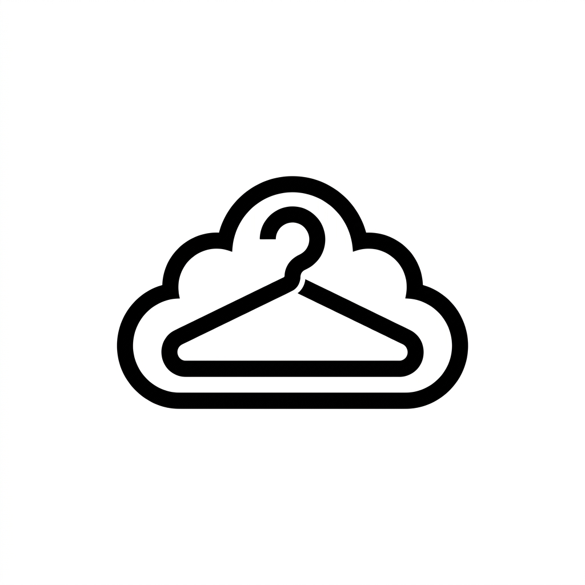

<div align="center">
  
  
  <h1>🛍️ DP-NubeStore Ecommerce</h1>
  <p><strong>Una tienda online diseñada para ofrecer una experiencia de compra sencilla y moderna.</strong></p>

  <p>
    
    
    
    
  </p>
</div>

---

## 📖 Sobre el Proyecto

**NubeStore** es un proyecto universitario desarrollado con un enfoque estricto en buenas prácticas de ingeniería de software. 

El frontend se desarrolló con tecnologías nativas como HTML y CSS, utilizando herramientas como Grid y Flexbox para construir una interfaz adaptable. En el backend se utilizó Java con JDBC para gestionar las conexiones a la base de datos y ejecutar consultas SQL directamente, sin recurrir a ORM.

---

## 🏗️ Arquitectura del Monorepo

Este repositorio está estructurado como un **Monorepo**, dividiendo claramente las responsabilidades entre el cliente y el servidor. Cada capa cuenta con su propia documentación detallada:

<table>
  <tr>
    <td align="center" width="50%">
      <h3>⚙️ Backend</h3>
      <p>API RESTful robusta construida con Java Spring Boot y persistencia directa vía JDBC.</p>
      <a href="./backend/README.md"><b>Ver Documentación del Backend →</b></a>
    </td>
    <td align="center" width="50%">
      <h3>🎨 Frontend</h3>
      <p>Interfaz de usuario interactiva y responsive construida con HTML5, CSS3 y Vanilla JS.</p>
      <a href="./frontend/README.md"><b>Ver Documentación del Frontend →</b></a>
    </td>
  </tr>
</table>

---

## 🚀 Características Destacadas

### 🔒 Backend
- **Cero ORM:** Transacciones SQL controladas manualmente (ACID).
- **Seguridad:** Encriptación de contraseñas con `BCrypt` y mitigación de ataques de enumeración.
- **Lógica de Base de Datos:** Uso avanzado de `CHECK`, `UNIQUE` y columnas autogeneradas en PostgreSQL.
- **Patrones de Diseño:** Implementación estricta de SOLID, Singleton, Factory y GRASP.

### ✨ Frontend
- **Diseño a Medida:** Estética premium "estilo editorial" inspirada en grandes marcas.
- **Responsive Nativo:** Layout adaptable mediante *Media Queries*, sin clases prefabricadas.
- **Modo Oscuro:** Tema dinámico persistente gestionado por variables CSS nativas.
- **Componentes Custom:** Modales, Toasts y menús *off-canvas* desarrollados con DOM puro.

---

## ⚙️ Configuración Rápida

Si deseas levantar el proyecto completo en tu entorno local, sigue estos pasos:

1. **Clona el repositorio:**
   ```bash
   git clone https://github.com/Usuario444/DP-NubeStore-Ecommerce.git
   cd DP-NubeStore-Ecommerce
   ```

2. **Crea la base de datos y ejecuta los scripts SQL:**
   ```bash
   # Crear la base de datos en PostgreSQL
   psql -U postgres -c "CREATE DATABASE nubestore_db WITH ENCODING 'UTF8';"

   # Ejecutar el esquema de tablas
   psql -U postgres -d nubestore_db -f backend/src/main/resources/db/schema.sql

   # Cargar los datos iniciales (vendedor oficial y catálogo base)
   psql -U postgres -d nubestore_db -f backend/src/main/resources/db/data.sql
   ```

3. **Configura la contraseña de PostgreSQL (variable de entorno):**
   ```bash
   # En Windows PowerShell:
   $env:NUBESTORE_DB_PASSWORD="tu_password_aqui"

   # En Linux / macOS:
   export NUBESTORE_DB_PASSWORD="tu_password_aqui"
   ```

4. **Inicia el Backend (Spring Boot):**
   ```bash
   cd backend
   mvn spring-boot:run
   ```
   *La API REST estará escuchando en `http://localhost:8080`.*

5. **Abre el Frontend:**
   Abre el archivo `frontend/index.html` directamente en tu navegador o mediante un servidor local (como *Live Server* en VS Code o el servidor integrado de IntelliJ IDEA en el puerto `63342`).
